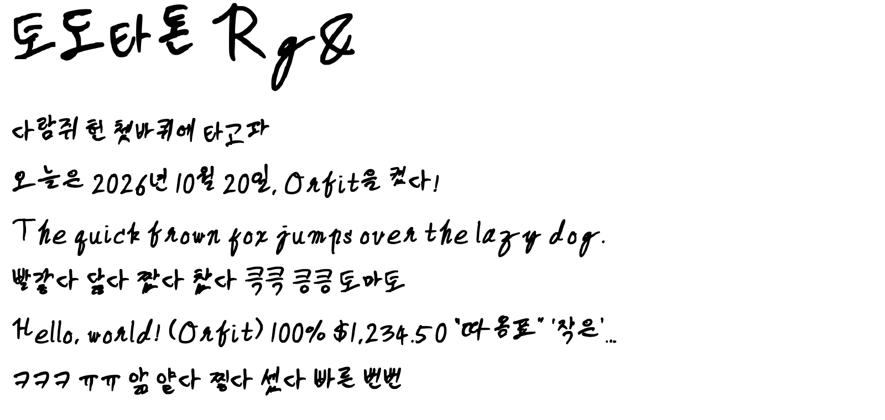

# 쮸니글씨체 (Junyeob Hand)

아이패드로 쓴 손글씨로 만든 웹 폰트. 한글 2,366자 + 자모 40자 + 영문·숫자·기호 100자.



## 바로 쓰기

### 웹 (CSS)

파일을 내 사이트에 같이 올리는 경우:

```css
@font-face {
  font-family: "Junyeob Hand";
  src: url("JunyeobHand.woff2") format("woff2");
  font-display: swap;
}
body { font-family: "Junyeob Hand", sans-serif; line-height: 1.6; }
```

파일을 올리지 않고 이 저장소에서 바로 불러오는 경우(jsDelivr CDN):

```css
@font-face {
  font-family: "Junyeob Hand";
  src: url("https://cdn.jsdelivr.net/gh/Shin-junyeob/settings@main/fonts/%EC%AE%B8%EB%8B%88%EA%B8%80%EC%94%A8%EC%B2%B4/out/JunyeobHand.woff2") format("woff2");
  font-display: swap;
}
```

- 없는 글자는 뒤에 적은 폰트(`sans-serif`)로 나온다. 상용 한글 2,350자 중 1,584자가 들어 있다.
- 꼬리가 긴 영문(Y·Z·g)이 있어 줄 높이가 크게 잡힌다. `line-height`로 조절할 것.

### 맥

`out/JunyeobHand.otf`를 더블클릭 → 서체 관리자에서 설치.

### 아이패드·아이폰

OTF 파일을 바로 설치할 수는 없고, 서체 설치를 지원하는 앱을 거쳐야 한다.
웹에서 쓰는 건 위 CSS만으로 된다(사파리 포함).

## 들어 있는 것

| 경로 | 내용 |
|---|---|
| `out/JunyeobHand.woff2` | 웹 폰트 (약 660KB) |
| `out/JunyeobHand.otf` | 설치용 폰트 |
| `out/preview.html` | 예시 문장 미리보기 (같은 폴더의 woff2를 씀) |
| `out/preview.png` | 미리보기 캡처 (macOS 렌더링) |
| `out/template.pdf` | 손글씨 템플릿 (빈 칸, 30쪽) |
| `out/template.json` | 템플릿 칸 좌표 — 글씨를 칸별로 자를 때 쓰는 기준 |
| `out/template_60percent.pdf` | 실제로 쓴 작성본 (1~20쪽) |
| `out/<글자>.png` | 받침 조합으로 만든 예시 10자 |
| `overrides/<글자>.png` | 나중에 다시 써서 바꿔 끼운 글자 ('토') |
| `make_template.py` | 템플릿 PDF·좌표 생성 |
| `compose_demo.py` | 칸 자르기 + 받침 바꿔 끼우기로 빠진 글자 만들기 |
| `build_font.py` | 외곽선 추출(potrace) → OTF·woff2 조립 |
| `data/gf-slices/` | 한글 빈도 순서 (Google Fonts `nam-files`, Apache-2.0) |

## 다시 만들기

[uv](https://docs.astral.sh/uv/)만 있으면 된다.

```sh
# 폰트 다시 빌드 (작성본·overrides가 바뀌었을 때)
uv run --no-project --with pymupdf --with numpy --with pillow --with scipy --with potracer \
  --with fonttools --with brotli python -I build_font.py out/template_60percent.pdf

# 받침 조합 규칙 자체 검사
uv run --no-project --with pymupdf --with numpy --with pillow --with scipy python -I compose_demo.py --check
```

**글자 하나만 다시 쓰고 싶을 때** — 아무 앱에서나 그 글자를 써서 캡처한 뒤 `overrides/<글자>.png`로 넣고 다시 빌드.
바탕색·크기·펜 굵기는 자동으로 맞춘다. (지금은 한글 음절만 지원)

**템플릿을 다시 만들 때는 주의** — `make_template.py`를 고쳐 다시 돌리면 `template.json` 좌표가 바뀌어
기존 작성본을 더 이상 자를 수 없다.

## 만든 방법

1. 한글을 웹 사용 빈도순으로 3단계로 나눈 템플릿을 아이패드에 띄워 2단계(1,439자, 위키백과 표본 기준 99.94%)까지 씀
2. 빠진 글자는 받침을 바꿔 끼워 조합 — 예: '갛' = '강'의 윗부분 + '낳'의 받침.
   받침은 ㅏ·ㅓ·ㅣ 계열 글자에서만 떼어 온다(ㅗ·ㅜ·ㅡ 계열은 모음이 받침에 붙어 딸려 오기 때문)
3. 회색조를 2배로 키우고 살짝 흐려 잔물결을 지운 뒤 potrace로 외곽선을 따서 OTF(CFF)로 조립

## 한계

- 받침 없는 글자는 조합하지 못한다(초성·모음 교체 미구현). 조합한 927자는 받침마다 재료 글자가 하나라 같은 모양이 반복된다.
- 커닝 없음. 한글 글자 폭·한영 세로 맞춤은 대략적인 규칙으로 정했다(`build_font.py`의 `ponytail:` 주석).
- PIL(FreeType)로 찍으면 중간 크기에서 획에 흰 틈이 보이지만 힌팅 문제이고, 브라우저·macOS에서는 생기지 않는다.
